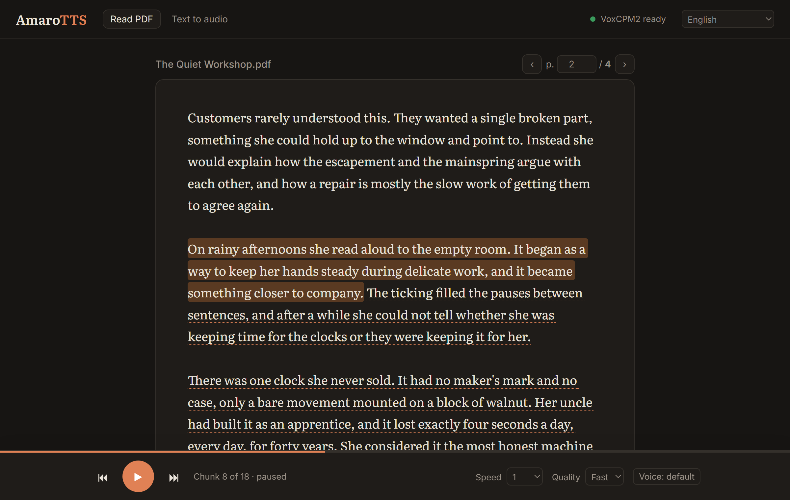
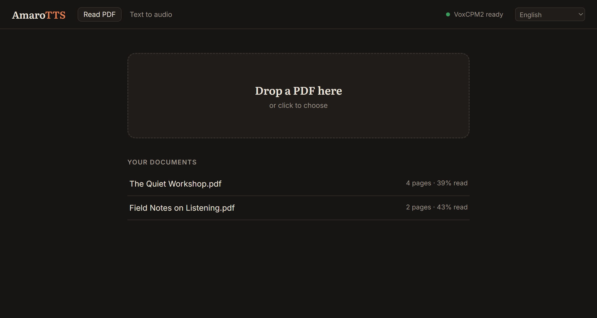
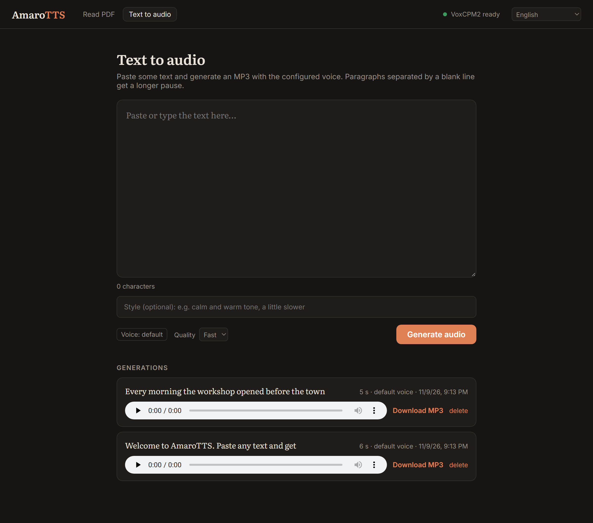

# AmaroTTS

A local, self-hosted web app that turns PDFs into speech. Upload a document, pick a page and
listen: audio is generated just ahead of where you are reading. Synthesis runs on
[VoxCPM2](https://huggingface.co/openbmb/VoxCPM2), patched to run on Intel Arc GPUs (XPU),
with a CPU fallback.



## Screenshots

| Library | Text to audio |
| --- | --- |
|  |  |

**Reader**: the chunk being read is highlighted, chunks whose audio is already generated are
underlined, and the player shows the position, speed, quality and voice. Click any sentence to
jump to it; use space / ← / → to control playback.

## Features

- **PDF read-aloud**: extracts text with PyMuPDF and cleans it up by removing repeated
  headers, footers and page numbers, fixing ligatures, rejoining hyphenated words and
  rebuilding paragraphs.
- **Lookahead synthesis**: generates the next 8 chunks after the cursor (~1.5 min of audio)
  and keeps them in a disk cache (2 GB cap).
- **Voice cloning**: upload a short reference clip (wav, flac, ogg or mp3, trimmed to 30 s
  and converted to mono) and every new audio uses that voice.
- **Text → MP3 export**: paste up to 50,000 characters and download the result as MP3. The
  export queue is saved to disk and picks up where it left off after a restart.
- **Priority scheduling**: one GPU worker thread serves both reading and exports, and
  reading always goes first.
- **Live updates** sent to the browser over Server-Sent Events.
- **Adjustable synthesis**: diffusion steps, CFG value and seed (defaults: 6 / 2.0 / 42).
  Changing settings or the voice invalidates cached audio automatically.
- **CLI**: `tts.py` synthesizes a single text straight to a WAV file.
- **100% test coverage** with pytest.

## Requirements

- Python 3.10+
- An Intel Arc GPU with a PyTorch build that has XPU support (optional; it falls back to the CPU,
  which is much slower)
- Python packages: `voxcpm`, `torch`, `fastapi`, `uvicorn`, `python-multipart`, `pymupdf`,
  `soundfile`, `numpy`
- libsndfile 1.1+ (needed for MP3 encoding through `soundfile`)

The VoxCPM2 model (`openbmb/VoxCPM2`) is downloaded from Hugging Face the first time you run it.

## Setup

```bash
python -m venv .venv
.venv/bin/pip install voxcpm fastapi uvicorn python-multipart pymupdf soundfile numpy
.venv/bin/pip install -r requirements-dev.txt   # for running tests
```

Install the PyTorch build that matches your hardware (for example the XPU build for Intel Arc)
by following the [PyTorch instructions](https://pytorch.org/get-started/locally/).

## Usage

Start the server and open http://localhost:8000:

```bash
./run.sh
```

### Windows

Requires [uv](https://docs.astral.sh/uv/). The first run creates a separate `.venv-win`
(Python 3.12 + PyTorch XPU), so it never touches the Linux `.venv`:

```bat
run.cmd
test.cmd
```

To reinstall or update the dependencies, run `powershell -ExecutionPolicy Bypass -File scripts\setup.ps1`.
On Windows the CLI is `.venv-win\Scripts\python.exe tts.py ...`.

### Data folder

Documents, audio cache, exports, settings and the reference voice are stored in `data/`. Set
`AMAROTTS_DATA_DIR` to use another folder, for example to run a second instance with its own
library. Each instance loads its own copy of the model, so two instances may not fit in GPU memory
together.

### CLI

Synthesize a single text from the command line:

```bash
.venv/bin/python tts.py "Hello world" -o out.wav
.venv/bin/python tts.py "Hello world" --ref my_voice.wav -o clone.wav
```

CLI options: `--ref`, `--prompt-wav` / `--prompt-text` (for "ultimate" cloning), `--cfg`,
`--steps`, `--seed`, `--device` (`auto` / `xpu` / `cpu`).

## API

| Method | Route | Description |
| --- | --- | --- |
| GET / POST | `/api/docs` | List / upload PDFs |
| GET | `/api/docs/{id}` | Document details |
| GET | `/api/docs/{id}/pages/{n}` | Page text and chunks |
| POST | `/api/docs/{id}/cursor` | Update the reading position |
| GET | `/api/docs/{id}/audio/{chunk}` | Audio for a chunk |
| GET | `/api/docs/{id}/events` | SSE stream for reading progress |
| GET / POST | `/api/exports` | List / create text → MP3 exports |
| GET | `/api/exports/events` | SSE stream for export progress |
| GET | `/api/exports/{id}/audio` | Download an export's MP3 |
| DELETE | `/api/exports/{id}` | Delete an export |
| GET | `/api/status` | Engine status, settings and voice |
| POST | `/api/settings` | Update synthesis settings |
| POST / DELETE | `/api/voice` | Upload / remove the reference voice |

## Internationalization (i18n)

The UI ships in **English** (default) and **Português (Brasil)**. The language is picked from the
browser settings, can be changed in the header, and the choice is remembered.

- Message catalogs live in `app/static/locales/<locale>.json`, with nested keys, `{name}`
  placeholders and plural objects (`{"one": …, "other": …}`, selected with `Intl.PluralRules`).
- Static markup is translated through `data-i18n` (text) and `data-i18n-<attr>` (for example
  `data-i18n-title`, `data-i18n-placeholder`); JavaScript calls `t("key", params)`.
- API errors return a stable `code` plus `params` (for example
  `{"detail": "text too long…", "code": "text_too_long", "params": {"max": 50000}}`). The UI shows
  the translation of `errors.<code>`, and `detail` is the English fallback.

To add a language, copy `en.json` to `<locale>.json`, translate the values and add the locale to
`LOCALES` in `app/static/i18n.js`. `tests/test_i18n.py` checks that every catalog has the same keys
and placeholders, and that every error code the backend raises has a translation.

## Project structure

```
app/
  api/         FastAPI routers (documents, exports, system, SSE)
  documents/   Document storage and reading service
  text/        PDF extraction, cleanup and chunking
  tts/         Synthesizer, GPU worker, reader cache, export queue, settings
  static/      Web UI (HTML, CSS, JS, i18n.js, locales/)
  container.py Dependency wiring
  server.py    App entry point
tests/         pytest suite
tts.py         Standalone CLI
data/          Runtime data: documents, exports, cache, settings, voice (git-ignored)
```

## Tests

```bash
./test.sh
```

This runs pytest with branch coverage (configured in `pyproject.toml`).
